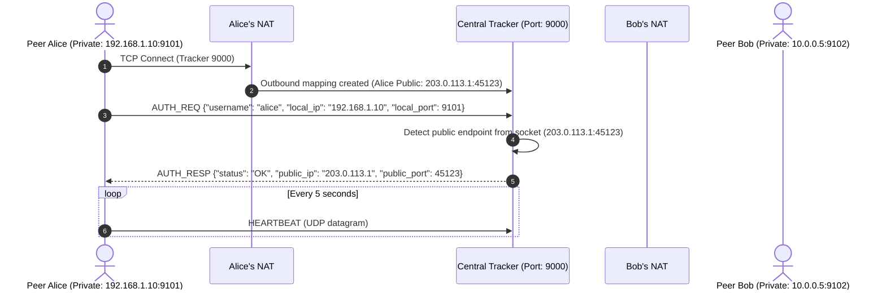
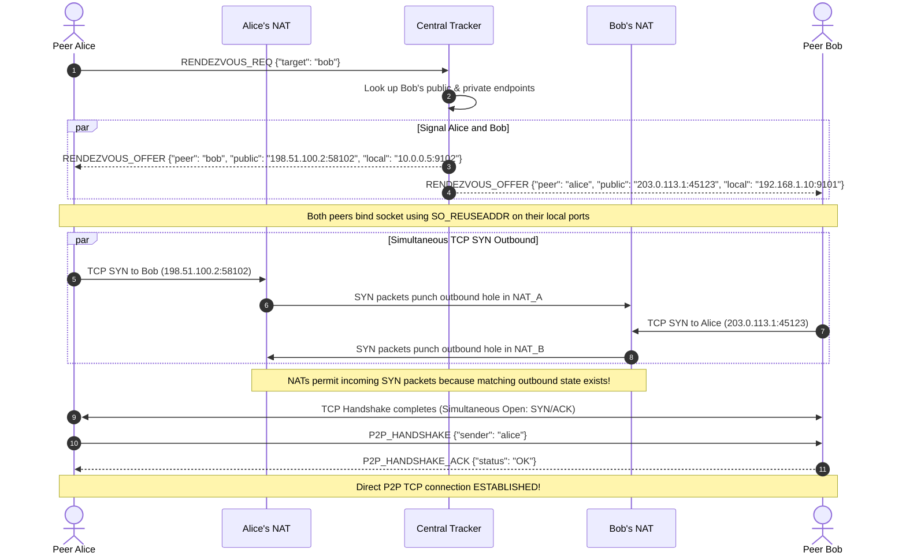
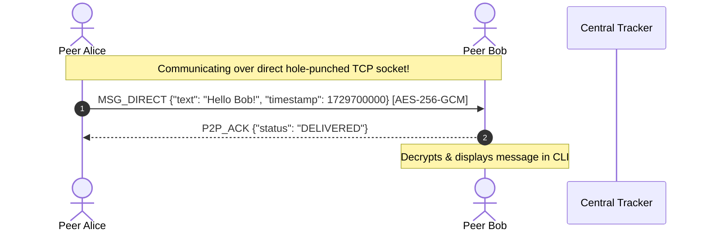
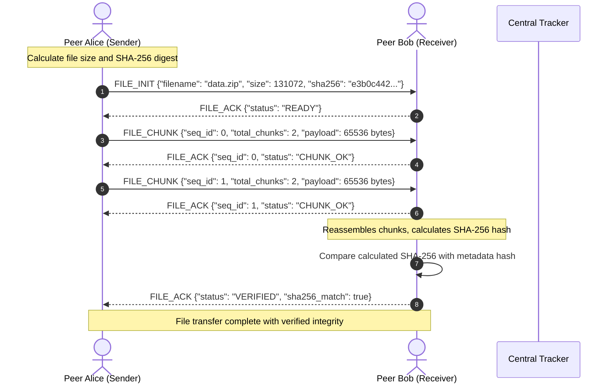

# Sequence Diagrams — Tracker-Coordinated P2P with TCP Hole Punching

Visual sequence flows for Tracker registration, NAT traversal via TCP Hole Punching, direct P2P text messaging, and direct P2P chunked file transfer.

---

## 1. Tracker Registration & Endpoint Discovery

---

## 2. TCP Hole Punching Flow (Simultaneous TCP Open)

---

## 3. Direct P2P Text Messaging (Unicast & Mesh Broadcast)

> **No Server Relay**: Messages flow directly across the hole-punched TCP connection.

---

## 4. Direct P2P 64KB Chunked File Transfer Flow

> **No Server Relay**: 64KB binary chunks and SHA-256 integrity acknowledgments stream directly between peers.

